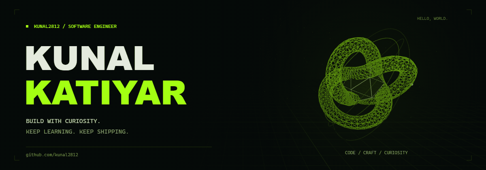

  <picture>
    <source media="(prefers-reduced-motion: reduce)" srcset="./assets/hacker-hero.png" />
    
  </picture>

  
  
  

## `> whoami`

**Kunal Katiyar** · Software engineer · India

Exploring machine learning, building useful software, and working through a good programming problem.

## `> stack`

**Languages**

**AWS &amp; serverless**

  
  
  
  

**Data &amp; distributed systems**

  
  
  
  

  
  
  

**Web &amp; machine learning**

**Toolkit**

## `> github --stats`

  
  

  

Stats and languages reflect public repositories. Activity follows GitHub's public contribution graph.

## `> practice`

[Codeforces](https://codeforces.com/profile/kunal0403) · [AtCoder](https://atcoder.jp/users/kunal0403) · [LeetCode](https://leetcode.com/kunal0403/) · [CodeChef](https://www.codechef.com/users/kunal0403) · [HackerEarth](https://www.hackerearth.com/@kunal0403)

---

<code>keep building. keep learning.</code>

